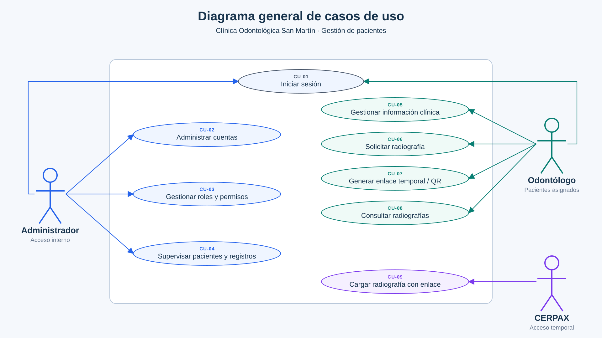

# 2.3.4 Casos de uso o modelo equivalente

El diagrama general presenta las responsabilidades principales de los actores del sistema web de la Clínica Odontológica San Martín. El Administrador gestiona cuentas y autorizaciones y supervisa los registros; el Odontólogo trabaja con información clínica de los pacientes asignados; y CERPAX entrega radiografías mediante un enlace temporal.

El inicio de sesión corresponde a los actores internos. El paciente se considera un registro clínico y no participa directamente en los casos de uso representados. CERPAX no requiere una sesión en el panel. Las asociaciones muestran responsabilidades principales, sin representar cada operación interna ni todos los accesos adicionales del Administrador.

**Figura: Diagrama general de casos de uso. Fuente: Elaboración propia.**

Se describen únicamente los casos de uso más relevantes para el Administrador, el Odontólogo y CERPAX: autenticación, administración de cuentas y permisos, gestión clínica y el proceso de solicitud, acceso temporal, entrega y consulta de radiografías. Se conservan los identificadores del diagrama general. Las operaciones se limitan a la clínica autorizada y, para el Odontólogo, a los pacientes asignados.

## CU-01. Iniciar sesión

- **Actor:** Administrador y Odontólogo.
- **Precondición:** Cuenta activa con credenciales y acceso a la clínica.
- **Flujo principal:** El actor introduce su correo y contraseña. El sistema verifica las credenciales y habilita las funciones correspondientes a sus permisos.
- **Alternativas:** Si las credenciales son incorrectas o la cuenta está inactiva, se rechaza el acceso. Si la sesión vence, debe autenticarse nuevamente.
- **Postcondición:** Sesión iniciada y acceso al panel según el perfil.

## CU-02. Administrar cuentas

- **Actor:** Administrador.
- **Precondición:** Sesión de Administrador activa.
- **Flujo principal:** Accede a Usuarios, crea o selecciona una cuenta, registra o modifica sus datos y guarda los cambios. Puede activar o desactivar cuentas.
- **Alternativas:** Los datos inválidos o un correo duplicado impiden guardar. El sistema impide desactivar al último Administrador activo.
- **Postcondición:** Cuenta creada, actualizada o con su estado modificado. La asignación del rol se realiza mediante CU-03.

## CU-03. Gestionar roles y permisos

- **Actor:** Administrador.
- **Precondición:** Sesión de Administrador activa; usuario existente para asignar roles.
- **Flujo principal:** Consulta o crea un rol, selecciona sus permisos y guarda. Desde una cuenta, asigna los roles que correspondan al usuario.
- **Alternativas:** No se permite eliminar roles del sistema ni roles asignados a usuarios. No se permite retirar los permisos del rol Administrador ni dejar el sistema sin un Administrador activo.
- **Postcondición:** Roles y permisos configurados y asignaciones de acceso registradas.

## CU-05. Gestionar información clínica

- **Actor principal:** Odontólogo.
- **Precondición:** Sesión activa y paciente asignado al odontólogo.
- **Flujo principal:** Consulta el paciente y registra o actualiza sus antecedentes y recetas mediante los módulos clínicos autorizados.
- **Alternativas:** Se rechazan datos inválidos. Los registros de pacientes no asignados no están disponibles para el odontólogo.
- **Postcondición:** Información clínica consultada o guardada en el registro correspondiente.

## CU-06. Solicitar radiografía

- **Actor principal:** Odontólogo.
- **Precondición:** Sesión activa; paciente asignado y permiso para crear solicitudes radiográficas.
- **Flujo principal:** Selecciona al paciente, indica el tipo de estudio y las indicaciones y registra la solicitud.
- **Alternativas:** Se rechaza la solicitud si faltan datos válidos o no existe la asignación del paciente al odontólogo responsable.
- **Postcondición:** Solicitud radiográfica registrada con estado Pendiente.

## CU-07. Generar enlace temporal / QR

- **Actor principal:** Odontólogo.
- **Precondición:** Sesión activa, acceso autorizado a una solicitud Pendiente y permiso para generar accesos.
- **Flujo principal:** Selecciona la solicitud y la vigencia del acceso. El sistema genera un enlace y su código QR para la carga externa y revoca los accesos anteriores pendientes de uso.
- **Alternativas:** Se rechaza una vigencia fuera del intervalo permitido o una solicitud que ya no esté Pendiente.
- **Postcondición:** Enlace y QR temporales disponibles para compartir con CERPAX.

## CU-08. Consultar radiografías

- **Actor principal:** Odontólogo.
- **Precondición:** Sesión activa y acceso autorizado al paciente y a la solicitud.
- **Flujo principal:** Consulta las solicitudes y su estado. Cuando existe un archivo, abre o descarga la radiografía desde el acceso protegido.
- **Alternativas:** Si no hay archivo cargado, no se permite abrirlo. Un odontólogo sin asignación no puede consultar el estudio.
- **Postcondición:** Estado o radiografía consultados; la consulta o descarga del archivo se registra como evento del sistema.

## CU-09. Cargar radiografía con enlace

- **Actor:** CERPAX.
- **Precondición:** Enlace temporal válido, vigente, no revocado y no utilizado para una solicitud Pendiente.
- **Flujo principal:** Abre el enlace o escanea el QR, selecciona un archivo admitido y confirma la carga. El sistema guarda el archivo protegido y lo asocia a la solicitud.
- **Alternativas:** Se rechazan enlaces vencidos, revocados o ya utilizados, así como archivos que incumplen las restricciones de tipo o tamaño. Si falla la carga, no se confirma como completada.
- **Postcondición:** Radiografía asociada a la solicitud, estado Completada y enlace consumido. Se genera la notificación de carga correspondiente.
